# ¿Dónde restaurar suelos en las partes altas de las cuencas de Monterrey para favorecer la infiltración, y cuánta agua gana el abasto?

**Reto 1 · Infiltración**, Grok Monterrey Build Day (14 oct 2026). Planteado por Antonio Hernández Ramírez (Pronatura Noreste).

**Equipo:** Pablo César Ruíz Hernández · David Martin Oliva Zavala · Zaddkiel de Jesus Martinez Alor

> *¿Dónde restaurar suelos en partes altas para favorecer la infiltración?*

En lo más crítico de 2022 (junio y julio), Cerro Prieto y La Boca bajaron a menos del 5 % de su capacidad, y la ZMM tuvo entre ~13,000 y ~13,500 L/s disponibles contra ~16,500 L/s de consumo regular (AP, 21 jun 2022; Grupo Legislativo PAN, Congreso NL, 2023). Son cifras del momento más crítico, no promedios anuales. La recuperación posterior ayuda, pero no elimina la vulnerabilidad ante sequías prolongadas. Esta herramienta prioriza **dónde** intervenir en las cuencas altas que abastecen a Monterrey, recomienda **qué obra** hacer en cada sitio y optimiza **exactamente dónde** trazar las barreras.

> El índice compara **potencial relativo**. **No** mide volumen de agua infiltrada.

**Ver el flujo de agua:** en la app local, el botón **▶ Ver flujo de agua (demo)** carga un sitio y anima una tormenta sin y con barreras.

**Demo en línea (versión estática):** https://pcruiher08.github.io/InflitracionAguaNuevoLeon/ : prioridad, robustez, cuencas de abasto y 8 sitios con barreras ya optimizadas. La versión completa e interactiva corre localmente (ver *Cómo correrlo*); la estática se regenera con `python -m pipeline.build_static`.

**Informe técnico en PDF (catorce preguntas de investigación, con apéndices):** [`docs/infiltracion-zmm.pdf`](docs/infiltracion-zmm.pdf) · [en línea](https://pcruiher08.github.io/InflitracionAguaNuevoLeon/infiltracion-zmm.pdf). Fuente en LaTeX en [`informe/`](informe/); todas las cifras se llenan desde los datos con `python informe/generar.py`. Para regenerar todo desde los datos: `bash informe/regenerar.sh` (Earth Engine, 1 a 2 horas); sólo figuras y PDF desde los JSON guardados: `bash informe/regenerar.sh --pdf`.

**Presentación para Pronatura (15 diapositivas, Beamer):** [`docs/presentacion-zmm.pdf`](docs/presentacion-zmm.pdf) · [en línea](https://pcruiher08.github.io/InflitracionAguaNuevoLeon/presentacion-zmm.pdf). Fuente: [`informe/presentacion_plantilla.tex`](informe/presentacion_plantilla.tex); las cifras se llenan con `informe/generar.py`, igual que el informe.

---

## La solución en 6 piezas

| # | Pieza | Pregunta que responde |
|---|---|---|
| 1 | **Mapa de prioridad** con pesos ajustables | ¿Dónde conviene restaurar? |
| 2 | **Mapa de robustez** | ¿Qué sitios son prioritarios sin importar cómo se ponderen los criterios? |
| 3 | **Ficha de obra** por sitio (motor de reglas) | ¿Qué obra hacer aquí y por qué? |
| 4 | **Optimización de captación para las presas** | Con *N* hectáreas, ¿dónde restaurar para retener más agua que llegue a cada fuente de abasto? |
| 5 | **Optimizador de ubicación de barreras** | ¿Exactamente dónde trazar las barreras para interceptar más escurrimiento? |
| 6 | **Simulación de tormenta** | ¿Qué cambia cuando llueve, sin barreras y con barreras? |

Todo es **determinista y auditable**: no hay modelos de lenguaje en la aplicación. Cada recomendación muestra las razones que la produjeron.

---

## Cómo funciona

### 1. Área de análisis: las cuencas que abastecen a la ZMM

En lugar de un rectángulo, el análisis cubre la **unión de las cuencas de abasto**, ~10,500 km². Para delimitarlas:

- Se ubicaron las presas con datos de agua superficial (JRC): La Boca ≈ 3.8 km², Cerro Prieto ≈ 20 km², El Cuchillo ≈ 43 km².
- Desde cada fuente se trazó la cuenca aguas arriba con **HydroBASINS nivel 12**, recorriendo los enlaces `HYBAS_ID → NEXT_DOWN`.

| Cuenca | Área | Papel en el abasto | Conectividad hidrológica *k* | Conexión en el índice |
|---|---|---|---|---|
| Presa La Boca | 347 km² | Presa de abasto directo | **1.0** | 0.5 |
| Presa Cerro Prieto (río Pablillo) | 1,758 km² | Presa de abasto directo | **1.0** | 0.5 |
| Río Santa Catarina aguas arriba de Monterrey | 1,392 km² | Recarga de pozos y galerías de SADM | **1.0** | 1.0 |
| Resto de la cuenca de El Cuchillo | 8,744 km² (incluye las anteriores salvo Cerro Prieto) | Abasto mayor, pero lejano | **0.6** | 0.3 |

Los niveles de conectividad son un **supuesto explícito**, ajustable en `pipeline/config.py`. La conectividad hidrológica *k* se usa para los volúmenes de agua; la conexión en el índice (`INDEX_CONNECTION`) refleja la ganancia neta esperada de cada fuente (sección 9).

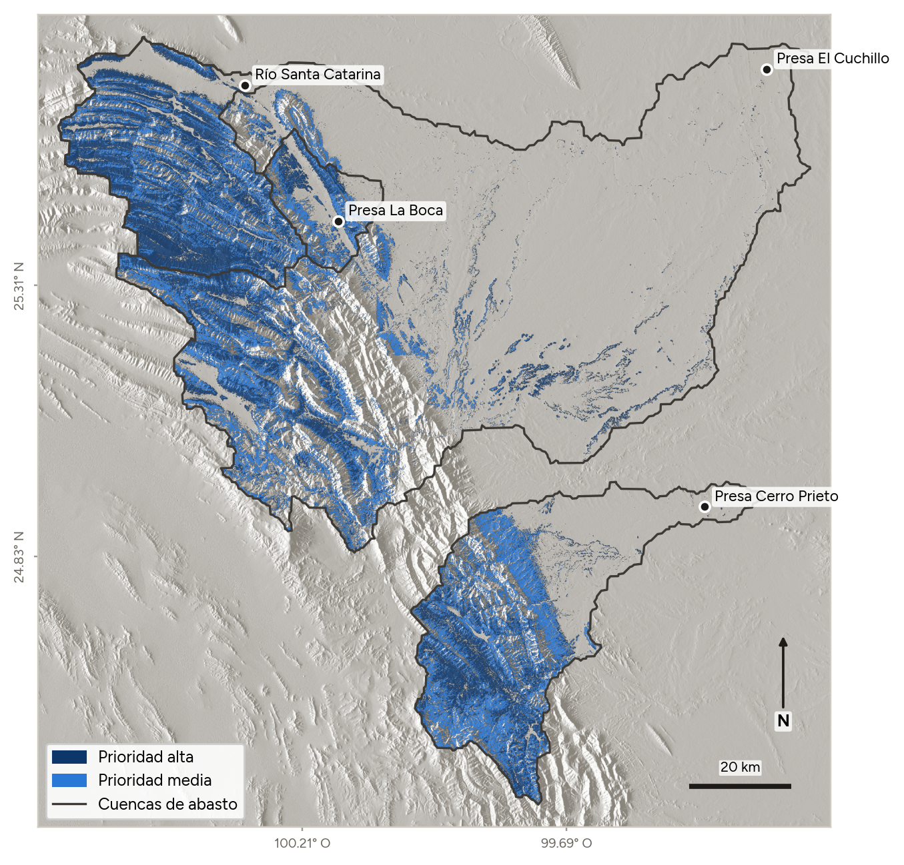


### 2. Índice de prioridad

Se calculan siete criterios en Google Earth Engine. Cada uno se normaliza a 0–1, donde 1 significa más prioridad para restaurar, y luego se combinan con una suma ponderada.

| Criterio | Qué captura | Peso por defecto |
|---|---|---|
| Pendiente | Laderas que generan escurrimiento y aún se pueden trabajar. Máximo entre 8° y 25°; baja a 0 hacia los 45°. | 0.20 |
| Vegetación degradada | NDVI bajo en temporada seca (Sentinel-2, feb–may): hay más que ganar | 0.25 |
| Suelo permeable | Arena − arcilla (%). Pesa poco porque en la zona casi no varía. | 0.05 |
| Incendios | Área quemada entre 2019 y 2026: 1 si fue en los últimos 3 años, 0.5 si antes | 0.10 |
| Suelo seco | Humedad superficial SMAP en temporada seca | 0.10 |
| Lluvia | Precipitación media anual (CHIRPS): más agua por captar | 0.10 |
| **Conexión con abasto** | Según la ganancia neta esperada de su fuente: río Santa Catarina 1.0, La Boca y Cerro Prieto 0.5 (la retención no añade volumen a las presas, pero reduce azolve y avenidas), resto de El Cuchillo 0.3 | 0.20 |

- **Clases:** alta si el índice supera 0.55, media entre 0.45 y 0.55, baja por debajo. Los umbrales se calibraron con la distribución real en laderas de más de 8°: equivalen a la mediana (~p50) y a ~p80.
- **Exclusiones:** zonas urbanas y cuerpos de agua (ESA WorldCover). El mapa muestra por defecto solo laderas de 8° o más.

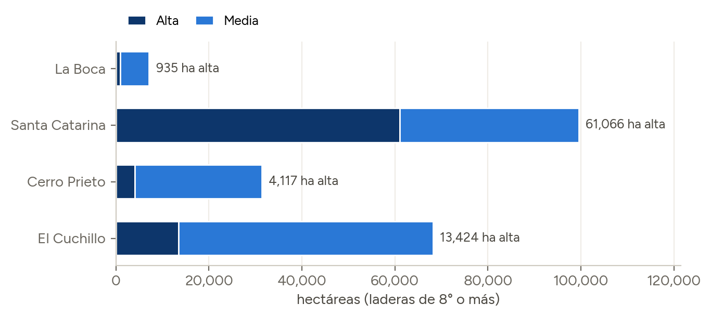

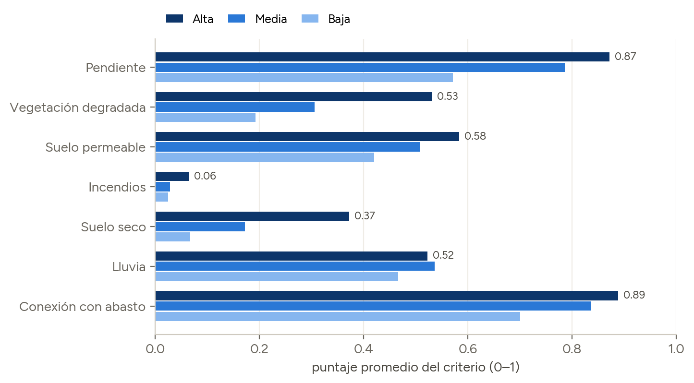


### 3. Robustez

Se recalcula el índice con **40 combinaciones aleatorias de pesos**. Para cada píxel se cuenta en qué porcentaje de esas combinaciones queda como prioridad alta. Los sitios con ≥ 50 % son prioritarios **sin importar cómo ponderen los criterios los expertos**: convierte el desacuerdo entre expertos en un resultado, en lugar de una debilidad.

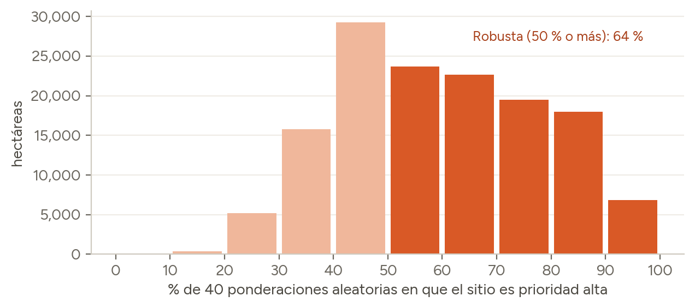


### ¿Qué significa cada prioridad?

Las tres cifras de resultados describen **lo mismo**: cuánto ganaría un terreno con restauración de suelo que favorezca la infiltración. Cambia solo qué tan estricto es el corte. Todas se cuentan en hectáreas de laderas de 8° o más dentro de las cuencas de abasto.

**Qué se mide.** Para cada píxel de 30 m, el índice (0 a 1) combina los siete criterios de la tabla anterior. Un píxel sale alto cuando su **suelo está degradado**, **genera escurrimiento**, **se puede trabajar** y **su agua llegaría a una fuente de abasto**: ahí es donde restaurar el suelo más ayuda a la infiltración.

| Clase | Regla | Superficie | Qué significa |
|---|---|---|---|
| **Prioridad alta** | Índice > 0.55 (~20 % superior de las laderas) | ~79,500 ha | Las mejores candidatas a restaurar |
| **Prioridad media** | Índice entre 0.45 y 0.55 | ~126,700 ha | Vale la pena restaurarlas, pero van en segundo lugar |
| **Alta y robusta** | Alta en ≥ 50 % de 40 ponderaciones aleatorias | ~56,500 ha (71 % de la alta) | Prioritarias **sin importar cómo se ponderen los criterios** |

**Por qué importa la robustez:** los pesos de los criterios son una decisión de criterio experto; alguien podría darle más peso a los incendios o menos a la pendiente. Lo robusto se mantiene alto con casi cualquier ponderación, así que es **el lugar más seguro para empezar**.

**Qué no miden:**

- **No miden volumen de agua.** El índice compara sitios entre sí: "alta" quiere decir "mejor que la mayoría", no "infiltra X m³". Las estimaciones en m³/año salen de la optimización de captación (sección 5).
- **No conocen las condiciones en campo:** tenencia de la tierra, acceso o restricciones de ANP. Todo sitio requiere verificación en campo.
- **La prioridad baja (índice < 0.45) no se muestra** en el mapa por defecto.

### 4. Ficha de obra (motor de reglas)

Al hacer clic en un sitio se muestrean las métricas en un radio de 250 m y se aplican reglas explícitas (`pipeline/obras.py`):

- **Urbano, agua, o plano con prioridad baja** → fuera de alcance.
- **Pendiente > 35°** → no construir obras; exclusión y regeneración natural.
- **Quemado recientemente** → barreras de material vegetal muerto, reutilizando el material quemado.
- **Pendiente ≥ 8° con suelo grueso** → barreras de piedra acomodada.
- **Pendiente suave con cobertura baja** → zanja-bordo + reforestación con nativas.
- **Ladera (≥ 8°) con cobertura media** (NDVI 0.35–0.55, lo típico en la zona) → barreras de material vegetal muerto en curvas de nivel.
- **Cobertura densa** (NDVI ≥ 0.55) → conservar la cobertura existente.

Para las barreras, el espaciamiento se calcula como intervalo vertical (1 m) / tan(pendiente), de donde salen los metros lineales por hectárea. La ficha se descarga en Markdown e incluye diagnóstico, datos, obra recomendada, dimensionamiento, riesgos y nivel de confianza.

### 5. Optimización de captación para las presas

Responde la pregunta de fondo: **¿dónde restaurar para que llegue más agua a las fuentes de abasto?** (`pipeline/optimize.py`, `POST /api/optimize`).

1. **Candidatas:** todo el territorio de las cuencas de abasto se divide en **celdas de 1 km**: 3,902 celdas con área elegible.
2. **Área elegible:** dentro de cada celda solo cuentan las hectáreas donde se pueden hacer obras: pendiente de 8° a 35°, sin zona urbana ni agua y sin cobertura densa (NDVI < 0.55). En total son 192,040 ha.
3. **Agua retenida por celda:**
    - Fórmula: *lluvia media × coeficiente de escurrimiento × hectáreas elegibles × ρ*, donde ρ es la fracción del escurrimiento anual que retienen las barreras.
    - El coeficiente sube con la pendiente y con el suelo desnudo: más agua escurre y hay más que frenar.
    - ρ sale del modelo de flujo de costo mínimo de las barreras con capacidad, ponderado por la lluvia diaria de CHIRPS: 16 % donde llueven 420 mm, 13 % con 640 mm y 7.8 % con 1,190 mm (en sitios lluviosos más agua cae en tormentas grandes que desbordan las barreras).
4. **Agua que llega al abasto:** el agua retenida se multiplica por la conectividad hidrológica *k* con la fuente (1.0 si drena directo a La Boca, Cerro Prieto o el río Santa Catarina; 0.6 en el resto de El Cuchillo). Cada celda se asigna a su fuente de abasto.
5. **Optimización:** dado un presupuesto de hectáreas, se eligen las celdas con más **m³ entregados por hectárea**. Es un programa lineal con una sola restricción de presupuesto; ordenar por rendimiento por hectárea es **óptimo** cuando las celdas se pueden tratar parcialmente. Hay dos modos:
    - **Máxima agua total:** el óptimo puro.
    - **Repartir entre fuentes:** el presupuesto se divide en partes iguales entre las 4 fuentes y se optimiza dentro de cada una.

**Resultado con 3,000 ha (agua bruta: cota superior, supone que toda el agua retenida llega a la fuente; ver sección 9):**

| Fuente | Máxima agua total | | Repartir entre fuentes | |
|---|---|---|---|---|
| Presa La Boca | 137 ha | 0.06 M m³ | 750 ha | 0.32 M m³ |
| Cuenca del río Santa Catarina (acuífero Campo Buenos Aires) | 2,659 ha | 1.25 M m³ | 750 ha | 0.37 M m³ |
| Presa Cerro Prieto | 204 ha | 0.09 M m³ | 750 ha | 0.34 M m³ |
| Presa El Cuchillo | 0 ha | 0.00 M m³ | 750 ha | 0.24 M m³ |
| **Total** | 3,000 ha | **1.41 M m³/año (44.6 L/s)** | 3,000 ha | **1.27 M m³/año (40.1 L/s)** |


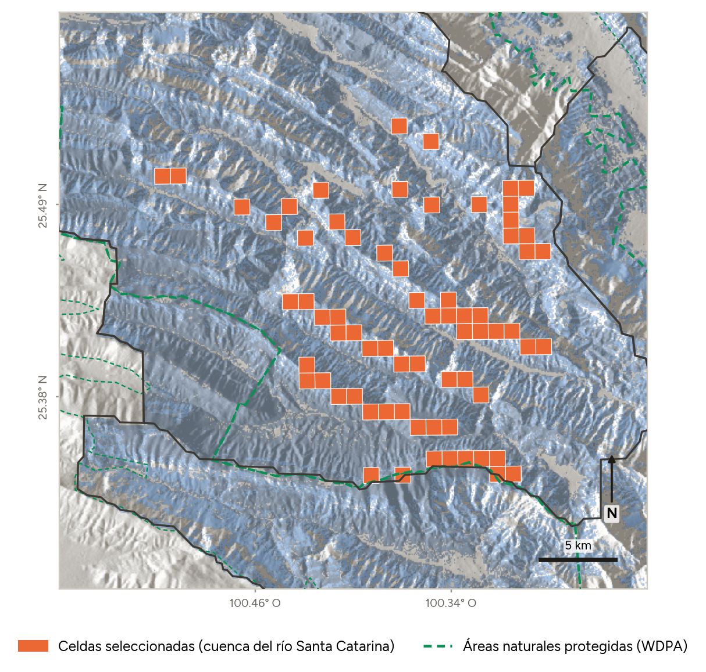

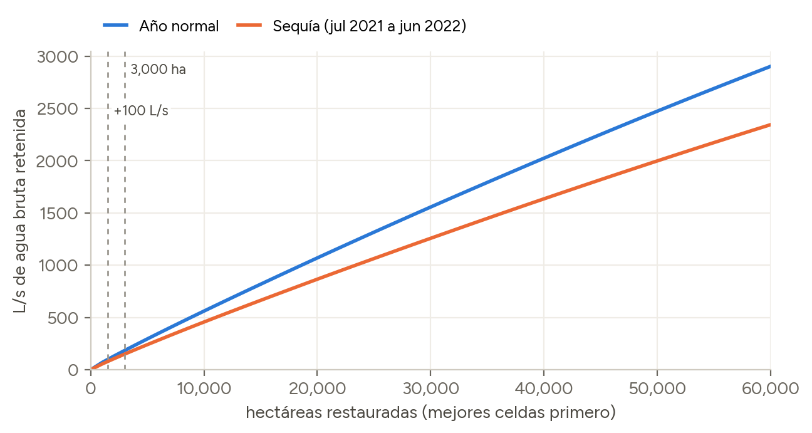

**Rendimientos decrecientes** (modo de máxima agua): 1,000 ha → 15 L/s · 3,000 ha → 45 L/s · 10,000 ha → 141 L/s · 20,000 ha → 273 L/s · 50,000 ha → 645 L/s.

- **La cuenca del río Santa Catarina rinde más por hectárea:** La Boca recibe más lluvia, pero buena parte cae en tormentas grandes que desbordan las barreras.
- **El Cuchillo rinde menos:** su conectividad hidrológica *k* vale 0.6.
- **Repartir cuesta poco:** cubrir las 4 fuentes da ~10 % menos agua total que el óptimo puro.
- **Máxima ganancia neta** (nuevo modo en la app y en la versión estática): selecciona sólo celdas donde la fuente gana agua en promedio. Con 3,000 ha, todas en la cuenca del río Santa Catarina: 44 L/s brutos y **+3 L/s netos esperados**. Con los otros dos modos la ganancia neta es de +1 L/s (máxima agua) y −8 L/s (repartir entre fuentes), porque incluyen cuencas de presas.

> Los m³ son **agua retenida bruta**, una cota superior: suponen que toda el agua retenida llega a la fuente. El informe en PDF incluye un análisis probabilístico de su destino (evapotranspiración y escurrimiento que ya llegaba a las presas): la ganancia neta es probablemente positiva sólo en el acuífero Campo Buenos Aires (~67 %), y en las cuencas de las presas la retención probablemente reduce el volumen que llega al embalse.

### 6. Optimizador de ubicación de barreras

Dentro de una ventana de ~1.2 km alrededor del sitio (`pipeline/barriers.py`):

1. **Relieve:** se descarga el DEM (NASADEM, 30 m) en UTM 14N, con margen extra para incluir el escurrimiento que llega desde ladera arriba.
2. **Hidrología en numpy:** relleno de depresiones (priority-flood), direcciones de flujo D8 y acumulación de flujo.
3. **Candidatas:** curvas de nivel cada 2–5 m de desnivel, según la pendiente, cortadas en segmentos de ~45 m.
4. **Cárcavas:** donde una curva cruza flujo concentrado (≥ 5 ha aguas arriba), el cruce se marca como **presa de piedra o gaviones en cárcava**. Los cauces de más de 100 ha se excluyen.
5. **Optimización:** dado un presupuesto en metros lineales, se eligen de forma voraz los segmentos que **interceptan más área de ladera arriba por metro**. Cada barrera retiene ~60 % de lo que le llega, así que las que quedan más abajo solo reciben crédito por lo que sigue escurriendo.
6. **Resultado:** barreras numeradas por prioridad, presas en cárcavas, red de escurrimiento, % de escurrimiento interceptado (relativo) y descarga en GeoJSON para SIG o apps de campo. Tarda ~0.5 s por sitio.

| Sitio | Presupuesto | Barreras | % de la ventana interceptado |
|---|---|---|---|
| Pilón (-100.05, 25.00) | 1,500 m | 37 | 60 % |
| Río Santa Catarina (-100.45, 25.45) | 1,500 m | 37 | 61 % |
| Río Santa Catarina (-100.45, 25.45) | 3,000 m | 74 | 77 % |

Duplicar el presupuesto rinde cada vez menos (61 % → 77 %), que es el comportamiento esperado de una buena optimización: los primeros metros van a donde más se intercepta.

**Con capacidad: minimum-cost maximum-flow (MCMF).** El trazo voraz por área ignora cuánta agua cabe en cada barrera. `pipeline/barriers_mcmf.py` modela la ladera como una red de flujo (un nodo por celda D8 y uno por barrera, con capacidad de 1.44 m³ por metro) y resuelve con *network simplex* de OR-Tools el flujo máximo de costo mínimo, que da el agua retenida respetando drenaje y capacidad. Las barreras se eligen con *lazy greedy* (CELF) usando como oráculo el flujo máximo de Dinic, equivalente a MCMF con estos costos (sección 15). En la app, el panel de barreras ofrece este método como «Con capacidad (flujo máximo)»; el trazo por área interceptada sigue disponible. Resultado: en tormentas pequeñas MCMF retiene hasta 2.6 % más que el trazo por área; en tormentas de 40 mm todas las barreras se llenan y ambos empatan. **En tormentas grandes limita la capacidad, no la posición**: 1,500 m de barreras retienen 27 a 31 % de una tormenta de 5 mm y sólo 3.4 a 4.2 % de una de 40 mm, que ocurre casi cada año.

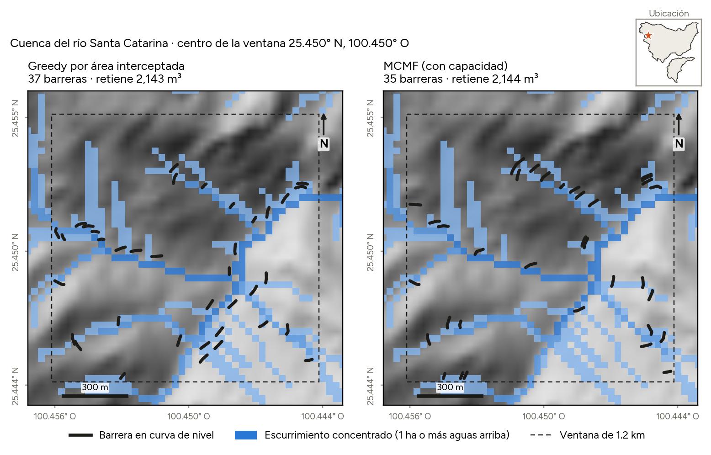

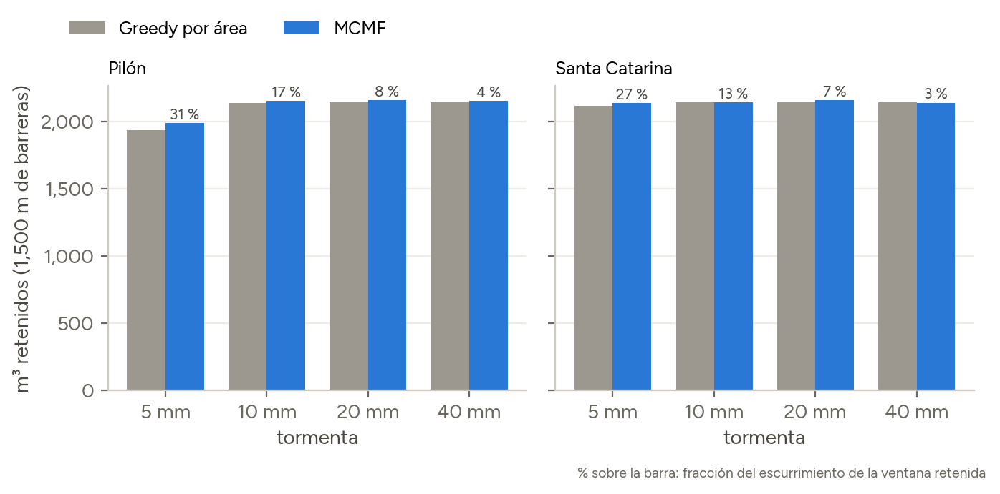


---

### 7. Simulación de tormenta: sin barreras vs con barreras

Anima cómo baja el agua por la ladera durante una tormenta, sobre el mismo terreno y con las barreras optimizadas (`pipeline/simulate.py`, `POST /api/simulate`).

1. **Tormenta:** 40 mm de lluvia uniforme sobre la ventana de ~1.2 km.
2. **Ruteo por celdas:** se usa la misma red de flujo D8 del optimizador. En cada paso el agua avanza una celda (~30 m) ladera abajo y la ladera degradada infiltra 1 mm por paso.
3. **Obras:** una barrera encharca una franja de ~3 m de ancho y 0.3 m de profundidad: hasta 30 mm por celda (≈ 27 m³), que infiltran a ~30 mm/h; las presas en cárcava hasta 67 mm. El excedente sigue escurriendo.
4. **Resultado en tres vistas:**
    - **Sin barreras:** el agua escurriendo ladera abajo (azul).
    - **Con barreras:** el mismo escurrimiento más el **agua retenida** por barreras y presas (aqua).
    - **Diferencia:** cuánto **bajó el flujo total** de la tormenta en cada celda (naranja). La reducción empieza en cada barrera y sigue cauce abajo.

    Además hay un hidrograma del agua que sale de la ventana (sin y con barreras) y un balance en m³. En la app local, el botón **▶ Ver flujo de agua (demo)** lo muestra en un clic.

En los 8 sitios sugeridos, con una tormenta de 40 mm, las barreras y presas en cárcava reducen en promedio **~11 %** el escurrimiento que sale de la ventana y **~12 %** el pico, y suman de 4,900 a 5,605 m³ infiltrados por tormenta.


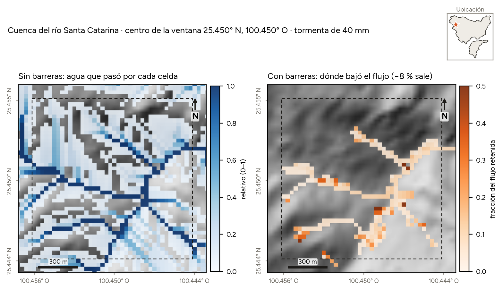

> Es un **modelo didáctico** para comparar escenarios sobre el mismo terreno y la misma tormenta. No modela humedad previa del suelo ni velocidades reales: no es un modelo hidrológico calibrado.

### 8. Cuánto aumentaría el abasto: agua bruta frente al déficit de 2022

La optimización se repite a escala de programa y se evalúa con la lluvia de julio de 2021 a junio de 2022. Aun en términos brutos, 30,000 ha aportarían ~361 L/s en un año como el previo a la crisis (~12 % de un déficit de 3,000 L/s), y la totalidad de las 192,040 ha elegibles, ~52 %.

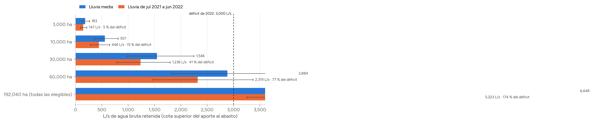

### 9. A dónde va el agua retenida (análisis probabilístico)

Las barreras no desvían el agua: la retienen unas horas para que se infiltre, y sigue por el subsuelo dentro de la misma cuenca. Por cada m³ retenido, la ganancia neta de la fuente es **G = (1 − e)·φ − τ**: *e* se pierde por evapotranspiración (cota superior de MODIS), *φ* del resto llega a la fuente y *τ* habría llegado de todos modos como escurrimiento. Con distribuciones uniformes y 4,000 escenarios de Monte Carlo (`informe/destino.py`):

| Fuente | G medio | P(G > 0) | P(G > 0), supuestos optimistas |
|---|---|---|---|
| Río Santa Catarina (acuífero Campo Buenos Aires) | +0.07 | 67 % | 99.7 % |
| La Boca | −0.30 | 5 % | 65 % |
| Cerro Prieto | −0.35 | 4 % | 51 % |
| El Cuchillo | −0.20 | 4 % | 58 % |

En la cuenca del río Santa Catarina el escurrimiento de tormenta cruza la ciudad y se pierde, así que infiltrarlo es recarga nueva. En las presas, lo retenido ya llegaba al embalse: ahí el valor de las obras está en menos azolve y avenidas más bajas, no en más volumen. Seleccionando por ganancia neta esperada, 30,000 ha (todas en la cuenca del río Santa Catarina) dan en promedio **~26 L/s netos** (intervalo de 90 %: −61 a 126) con supuestos conservadores. Con la evapotranspiración que estima un balance diario del suelo detrás de las barreras (~7 %, sección «Evapotranspiración del agua infiltrada»), serían **~156 L/s**, positivos con probabilidad cercana a 100 %.

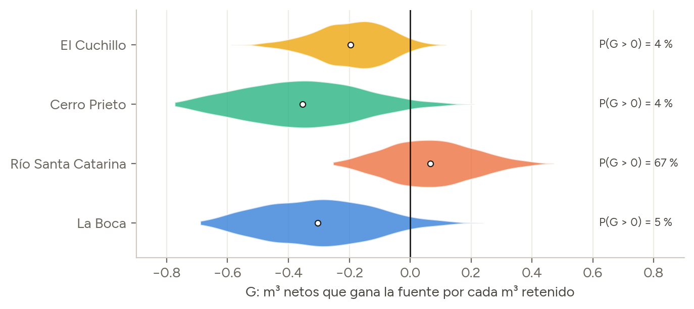

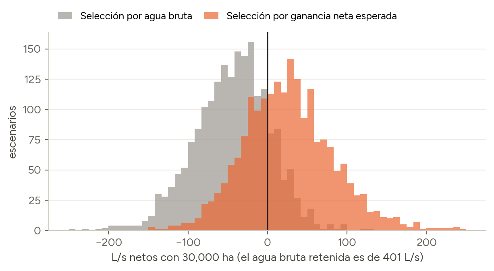

### 10. Vegetación nativa para cada obra

Cada ladera se restaura **sólo con especies de su propio tipo de vegetación**, tomado de la carta de uso del suelo y vegetación del **INEGI, serie VII** (1:250,000, obtenida del servicio de mapas IDEFOR de CONAFOR; `informe/vegetacion.py`) y confirmado en campo, con material de procedencia local y densidad moderada (una cobertura densa eleva la evapotranspiración y baja la ganancia neta). Con 3,000 ha seleccionadas por ganancia neta: pino y pino-encino 1,230 ha, matorral submontano 934 ha, encino 366 ha, oyamel y ayarín 315 ha, matorral desértico 150 ha.

| Tipo de vegetación (INEGI) | Especies de referencia (inventarios en Nuevo León) | Obra |
|---|---|---|
| Matorral submontano | *Acacia amentacea*, *Zanthoxylum fagara*, *Leucophyllum frutescens*, *Cordia boissieri*, *Helietta parvifolia* | Material vegetal muerto; arbustos ladera arriba de cada barrera |
| Matorral desértico rosetófilo y micrófilo | *Agave lecheguilla*, *Larrea tridentata*, *Koeberlinia spinosa*, *Fouquieria splendens* | Piedra acomodada con lechuguilla en hilera |
| Bosque de encino y encino-pino | *Quercus canbyi*, *Q. glaucoides*, *Q. laceyi*, *Juniperus*, *Arbutus xalapensis* | Zanja-bordo y reforestación con encinos y enebros |
| Bosque de pino y pino-encino | *Pinus pseudostrobus*, *Q. rysophylla*, *Q. canbyi*, *Juniperus flaccida* | Material vegetal muerto en áreas quemadas y regeneración natural |
| Bosque de oyamel y ayarín | Sin lista: requiere inventario de campo (posibles especies en NOM-059) | Sólo conservación de suelo |
| Pastizal inducido o agricultura | Las del tipo de vegetación natural contiguo | La obra que corresponda a la pendiente |

Fuentes y discusión completa en el informe (sección P10).

### 11. Calibración con el balance hídrico oficial

El escurrimiento natural de la cuenca de Cerro Prieto según CONAGUA (cuencas Río Pablillo 1, Río Camacho y Río Pablillo 2) es de **166.5 mm/año** (coeficiente 0.25); el modelo da 223.9 mm. Con una actualización bayesiana por muestreo de importancia (`informe/calibracion.py`), el factor de escurrimiento baja a 0.82: el agua bruta y la neta bajan ~18 %, y la probabilidad de ganancia neta positiva no cambia (30,000 ha en la cuenca del río Santa Catarina: 20.8 L/s netos en promedio, P > 0 = 67 %).

### 12. Azolve evitado en las presas (RUSLE)

Con la ecuación universal de pérdida de suelo revisada (`informe/sedimento.py`), 30,000 ha en la cuenca de Cerro Prieto evitarían que lleguen en promedio ~481 mil m³/año de sedimento a la presa (**~24.0 hm³ en 50 años**, ~8.0 % de su capacidad), pero reducirían el agua que le llega en ~4.0 hm³/año. En las presas, el azolve evitado no compensa el agua retenida.

### 13. Costo

Con un costo **supuesto** de 25,000 a 50,000 pesos por hectárea (la cota inferior es un supuesto propio; la superior, el tope del subsidio de CONAFOR para restauración forestal, Reglas de Operación 2026; ninguna es un costo medido de obra), cada **L/s neto cuesta ~43 millones de pesos**, más de diez veces el costo de capital por L/s del acueducto El Cuchillo II (~2.9 millones). Como fuente de agua la restauración es cara; su valor está en el suelo, la vida útil de los embalses, las avenidas y la biodiversidad.

### 14. Áreas protegidas y clima futuro

- **Parque Nacional Cumbres de Monterrey:** 2,933 de las 3,000 ha seleccionadas por ganancia neta están dentro del parque (WDPA). La restauración es compatible con un parque nacional (LGEEPA, art. 50), pero requiere autorización de la CONANP.
- **Clima (NEX-GDDP-CMIP6, 8 modelos, 2041 a 2070):** un año tan seco como 2021 a 2022 (percentil 11 histórico) tendría una frecuencia media de 10 % en SSP2-4.5 y 12 % en SSP5-8.5, con mucha dispersión entre modelos (3 a 23 %). El agua bruta cambiaría entre −0.7 % y +1.6 %.

### 15. Tres algoritmos para calcular el agua retenida

La selección de barreras evalúa miles de veces cuánta agua retiene un conjunto de barreras. Se compararon tres oráculos (`informe/oraculos.py`, 620 evaluaciones en 5 sitios y 4 tormentas):

| Oráculo | ms por evaluación (mediana) | Error frente al exacto | Selección completa (10 casos) |
|---|---|---|---|
| *Minimum-cost maximum-flow* (*network simplex*, OR-Tools) | 51 | exacto | 731 s |
| *Maximum flow* con el algoritmo de Dinic | 4 | exacto (idéntico en todos los casos) | 5 s, mismas barreras |
| *Topological greedy fill* | 2 | −0.8 % en promedio, hasta −12.6 % | 22 s, −0.3 % de retención |

Con los costos de este problema (−1 en los arcos de las barreras, 0 en los demás), el *minimum-cost maximum-flow* equivale a un flujo máximo en la red sin salidas, y el informe lo demuestra. Dinic da el mismo resultado ~13 veces más rápido por evaluación y ~135 veces más rápido en la selección completa. El *minimum-cost maximum-flow* sólo vuelve a ser necesario con costos diferenciados por barrera.

### Condiciones para escalar

Empezar con un **piloto en los 8 sitios de la cuenca del río Santa Catarina** y escalar sólo si:

1. **El acuífero gana agua:** la evapotranspiración medida del agua infiltrada, *e*, es menor que el umbral *e\* = 1 − τ/φ* (entre 0.20 y 0.89 según la fracción que llega al acuífero, φ, y la que ya llegaba sin obras, τ). El balance del suelo estima *e* ≈ 7 %, por debajo de todos los umbrales: si se confirma, la decisión depende sobre todo de φ y τ.
2. **La evidencia alcanza:** el intervalo de 90 % de la ganancia neta medida en campo queda por encima de cero (al menos 16 pares de microcuencas, dos o tres temporadas).
3. **El agua llega y las obras duran:** trazadores que confirmen que el agua infiltrada llega al acuífero Campo Buenos Aires y limpieza periódica del sedimento.
4. **No se justifica como agua barata:** igualar el costo por L/s de El Cuchillo II exigiría una ganancia neta de 0.66 a 1.32 m³ por m³ retenido; el máximo plausible es 0.53. El escalamiento se justifica por el suelo, los embalses, las avenidas y la biodiversidad.
5. **En las presas,** sólo con objetivos de suelo y azolve.
6. **Con autorización de la CONANP** y sólo especies nativas de cada ladera.

### Evapotranspiración del agua infiltrada

`informe/evapotranspiracion.py` estima *e*, la fracción del agua infiltrada detrás de las barreras que regresa a la atmósfera:

1. **Satélites** (MODIS MOD16A2GF, PML, TerraClimate y FLDAS, 2015 a 2023): en las laderas de la cuenca del río Santa Catarina se evapotranspira de 77 a 113 % de la lluvia ordinaria. Los productos difieren mucho entre sí y los valores mayores que 1 sugieren que CHIRPS subestima la lluvia de la sierra. Es una cota superior de *e*.
2. **Balance diario del suelo** detrás de la barrera (lluvia CHIRPS, evapotranspiración potencial TerraClimate, zona de raíces de 3 a 15 m de ancho y 50 a 400 mm de agua disponible): cada metro de barrera recibe el escurrimiento de ~600 m² de ladera, la zona de raíces se satura y sólo **~7 %** del agua retenida se evapotranspira; el resto drena por debajo de las raíces (recarga concentrada).

Si se confirma, la ganancia neta con 30,000 ha en la cuenca del río Santa Catarina pasaría de ~26 a **~156 L/s**, con probabilidad cercana a 100 % (88 % con pérdidas moderadas por karst): el análisis base es conservador. El costo por L/s neto (~7 millones de pesos) sigue por encima del de El Cuchillo II.

**Cómo medirla en campo:** lisímetros de drenaje detrás de las barreras y en laderas testigo; sensores de humedad del suelo a 30, 60 y 100 cm; flujo de savia en los árboles cercanos (qué tan lejos alcanzan las raíces el agua retenida); isótopos estables del agua (δ¹⁸O, δ²H) y balance de cloruro, que indican qué parte se evaporó antes de recargar; y covarianza de remolinos para calibrar los productos satelitales.

### Limitación principal

No se sabe **a dónde va el agua infiltrada**. Con los supuestos base, la evapotranspiración del agua infiltrada explica ~47 % de la incertidumbre de la ganancia neta en la cuenca del río Santa Catarina, el escurrimiento que ya llegaba al acuífero ~38 % y la ruta subterránea al acuífero ~14 %. Si el karst desvía agua por fallas, la ruta subterránea pasa a dominar (~38 %) y puede volver negativa la ganancia. Si la evapotranspiración es tan baja como estima el balance del suelo, su peso disminuye y la ruta subterránea y el escurrimiento que ya llegaba pasan a ser lo principal; además es la más difícil de medir (trazadores). El azolve de las barreras le sigue, pero se resuelve con limpieza periódica. Lo demás son limitaciones de resolución y calibración.

### Karst y azolve de las barreras (sensibilidad)

`informe/sensibilidad.py`, a partir de resultados guardados:

- **Karst:** si parte del agua infiltrada sale por fallas hacia otras cuencas (fracción que llega al acuífero entre 0.2 y 0.9), la probabilidad de ganancia neta en la cuenca del río Santa Catarina baja de 67 % a 48 %, y la ganancia esperada con 30,000 ha de ~26 a ~1 L/s; con pérdida alta (0.1 a 0.5), la ganancia es negativa. La conectividad debe medirse con trazadores.
- **Azolve de las barreras:** cada metro de barrera drena ~600 m² de ladera. Con la erosión de la RUSLE, el almacenamiento encharcado (0.9 m³/m) se llena en ~0.3 años; aun con erosión diez veces menor, en ~3 años. Sin limpieza sólo queda la infiltración (37.5 % de la capacidad) y la ganancia neta bajaría de ~26 a ~10 L/s. El costo de mantenimiento no está en el costo por L/s.

Los trazos de barreras son **pruebas de concepto** con un DEM de 30 m, no planos de construcción: requieren LiDAR o levantamiento con dron.

**Convención estadística:** los resultados de Monte Carlo se reportan como **media** (valor esperado, que se suma entre celdas y años y es el que corresponde a costos) con su intervalo de 90 %. La mediana sólo se usa para describir distribuciones y para tiempos de cómputo.

### 16. Validación en campo

El informe propone un diseño antes y después con control e impacto en los 8 sitios: microcuencas pareadas con vertedores (τ), perfiles de humedad del suelo y balance de cloruro (e) y piezómetros en la cuenca del río Santa Catarina (φ). Con CV = 0.5, α = 0.05 y potencia de 80 %, se necesitan ~16 pares para detectar una diferencia de 50 % y ~63 para una de 25 %.

El informe incluye además un **resumen ejecutivo de una página**.

## ¿Por qué estos sitios?

Los 8 sitios sugeridos **no se eligen a mano**. Salen de la **optimización por ganancia neta esperada** (sección 9):

1. Se corre la optimización en modo **máxima ganancia neta** con 3,000 ha. Sólo entran celdas donde la fuente de abasto gana agua en promedio, y todas resultan en la cuenca del **Santa Catarina**.
2. Se toman las mejores celdas en orden, **separadas al menos 3 km**, y se analiza el punto central de cada una.
3. Solo se conservan los sitios donde el motor de reglas recomienda una **obra de barreras, zanjas o reforestación con barreras**.
4. En cada sitio se optimizan las barreras con 1,500 m lineales.

| # | Lugar en la optimización | m³/ha/año brutos | m³/ha/año netos | Lluvia · coef. escurrimiento | Prioridad · robustez | Obra recomendada | Barreras · m · % interceptado | Área protegida |
|---|---|---|---|---|---|---|---|---|
| 1 | #3 | 500 | +33 | 642 mm · 0.6 | 0.57 · 38% | Reforestación con nativas + barreras de material vegetal | 35 · 1,482 m · 70% | Cumbres de Monterrey |
| 2 | #5 | 386 | +33 | 665 mm · 0.582 | 0.73 · 96% | Barreras de piedra acomodada | 40 · 1,497 m · 53% | C.A.D.N.R. 026 Bajo Río San Juan |
| 3 | #8 | 487 | +33 | 635 mm · 0.587 | 0.55 · 35% | Reforestación con nativas + barreras de material vegetal | 38 · 1,486 m · 69% | Cumbres de Monterrey |
| 4 | #12 | 473 | +32 | 673 mm · 0.567 | 0.62 · 68% | Barreras de piedra acomodada | 36 · 1,498 m · 66% | Cumbres de Monterrey |
| 5 | #15 | 382 | +32 | 673 mm · 0.561 | 0.51 · 25% | Barreras de material vegetal muerto en curvas de nivel | 40 · 1,499 m · 68% | Cumbres de Monterrey |
| 6 | #18 | 478 | +32 | 677 mm · 0.558 | 0.58 · 51% | Reforestación con nativas + barreras de material vegetal | 40 · 1,491 m · 55% | Cumbres de Monterrey |
| 7 | #21 | 475 | +32 | 642 mm · 0.569 | 0.57 · 50% | Reforestación con nativas + barreras de material vegetal | 35 · 1,493 m · 61% | Cumbres de Monterrey |
| 8 | #32 | 468 | +31 | 655 mm · 0.556 | 0.66 · 81% | Reforestación con nativas + barreras de material vegetal | 39 · 1,497 m · 57% | Cumbres de Monterrey |

**Cómo leer la tabla:**

- **Todos los sitios están en la cuenca del río Santa Catarina.** Ahí el escurrimiento de tormenta cruza la ciudad y se pierde, así que infiltrarlo en la sierra es recarga nueva para el acuífero de los pozos de SADM. En las cuencas de las presas, retener escurrimiento en la ladera probablemente reduce el agua que llega al embalse (sección 9).
- **Bruta frente a neta.** Cada hectárea retiene del orden de 400 a 500 m³/año (agua bruta), pero la ganancia neta esperada para el abasto es de ~30 m³/ha/año con supuestos conservadores (probabilidad de ser positiva ~67 %), o de ~165 m³/ha/año con la evapotranspiración del balance del suelo.
- **7 de los 8 sitios están en el Parque Nacional Cumbres de Monterrey.** La restauración es compatible con un parque nacional, pero requiere autorización de la CONANP.
- **El índice de prioridad mide otra cosa.** Algunos sitios óptimos tienen prioridad media o robustez baja: el índice pesa también degradación, incendios y suelo. **Las dos vistas se complementan.**

### ¿Por qué las barreras quedan donde quedan?

En cada sitio, el optimizador elige las barreras así:

- **Valor de una barrera:** cada segmento de curva de nivel vale el **área de ladera arriba cuyo escurrimiento lo cruza**.
- **Selección:** se eligen primero los segmentos que interceptan **más área por metro construido**.
- **Sin duplicar crédito:** una barrera justo debajo de otra ya elegida solo recibe crédito por el ~40 % del escurrimiento que la de arriba no retiene. Por eso las barreras quedan **repartidas por la ladera**, cruzando los flujos principales, y no amontonadas en una sola línea de drenaje.
- **Cárcavas:** donde el flujo se concentra (≥ 5 ha aguas arriba), una barrera lineal no aguanta. Ahí se proponen **presas de piedra o gaviones en cárcava**, ordenadas por área de aporte.
- **Rango de pendiente:** las curvas en tramos con pendiente menor a 3° o mayor a 35° se descartan.

---

## Datos utilizados (todos abiertos)

| Dato | Fuente | Uso |
|---|---|---|
| Elevación 30 m | NASA NASADEM (`NASA/NASADEM_HGT/001`) | Pendiente, curvas de nivel, flujo |
| Imágenes 10 m | Copernicus Sentinel-2 SR (`COPERNICUS/S2_SR_HARMONIZED`) | NDVI de temporada seca, 2024–2026 |
| Cobertura del suelo | ESA WorldCover v200 | Excluir zonas urbanas y agua |
| Textura, arena y arcilla | OpenLandMap (USDA) | Permeabilidad del suelo |
| Área quemada | MODIS MCD64A1 v6.1 | Incendios 2019–2026 |
| Precipitación | CHIRPS diario | Lluvia media anual 2019–2026 |
| Humedad del suelo | NASA SMAP L4 v8 | Humedad superficial en temporada seca |
| Cuencas | WWF HydroSHEDS / HydroBASINS nivel 12 | Delimitar cuencas de abasto y conectividad |
| Agua superficial | JRC Global Surface Water 1.4 | Ubicar las presas |
| Evapotranspiración | MODIS MOD16A2GF | Destino del agua retenida (2015 a 2024) |
| Uso del suelo y vegetación | INEGI serie VII, 1:250,000 (vía CONAFOR IDEFOR) | Tipo de vegetación de referencia |
| Áreas protegidas | WDPA (UNEP-WCMC y UICN) | Parque Nacional Cumbres de Monterrey y otras |
| Clima futuro | NASA NEX-GDDP-CMIP6 | Frecuencia de sequías 2041 a 2070 |
| Balance hídrico | CONAGUA: escurrimiento natural por cuenca y disponibilidad del acuífero Campo Buenos Aires | Calibración y contraste |
| Mapa base | Esri Light Gray Canvas + World Hillshade | Visualización |

---

## Qué podemos concluir

Cifras con la cobertura completa de las cuencas de abasto (`scores_v2`), en laderas de 8° o más.

1. **La prioridad se concentra en las laderas de la Sierra Madre, sobre todo en la cuenca del río Santa Catarina.** Hay ~**79,500 ha de prioridad alta** (~74,400 ha entre 8° y 35°, aptas para obras, y ~5,200 ha de más de 35°, para regeneración natural) (~61,100 ha en la cuenca del río Santa Catarina) y ~126,700 ha de prioridad media.
2. **La conexión con el abasto pesa según la ganancia neta.** La cuenca del río Santa Catarina, donde la recarga es agua nueva para los pozos de SADM, puntúa 1.0; las cuencas de las presas, 0.5. ~**66,100 ha (83 %)** de la prioridad alta están en las cuencas de La Boca, Cerro Prieto o el río Santa Catarina.
3. **La prioridad es robusta.** ~**56,500 ha (71 % de la prioridad alta)** se mantienen como prioridad alta en al menos la mitad de 40 ponderaciones aleatorias.
4. **Los incendios abren una ventana de acción.** ~**14,800 ha** de prioridad alta tuvieron incendios entre 2019 y 2026; ahí urge actuar y el material quemado sirve para barreras.
5. **Con 3,000 ha bien elegidas se retienen del orden de 1.4 millones de m³/año (~45 L/s; media de Monte Carlo 44.7 L/s, intervalo de 90 % de 26 a 68 L/s).** Es agua retenida bruta. Frente al déficit de ~3,000 a 3,500 L/s en lo más crítico de 2022, aun 30,000 ha (≈361 L/s brutos en un año como el previo a la crisis) cubrirían ~12 %. Al descontar la evapotranspiración y el escurrimiento que ya llegaba a las presas, la ganancia neta sólo es probablemente positiva en el **acuífero Campo Buenos Aires** (~26 L/s con 30,000 ha y supuestos conservadores; ~156 L/s si se confirma en campo la baja evapotranspiración del agua concentrada detrás de las barreras); en las presas el beneficio está en menos azolve y avenidas más bajas, no en más volumen. **La restauración no sustituye otras fuentes.**
6. **Dónde restaurar depende del objetivo:**
    - Para maximizar agua: **la cuenca del río Santa Catarina**, que además es donde la ganancia neta es más probable.
    - Para cubrir todas las fuentes: repartir cuesta ~10 % del agua bruta, pero en ganancia neta el reparto es negativo (−8 L/s con 3,000 ha), porque asigna superficie a las cuencas de las presas.
7. **Las laderas muy empinadas no son para obras.** Por encima de ~35–45° conviene la exclusión y la regeneración natural.
8. **El trazo importa en tormentas frecuentes; en las grandes manda la capacidad.** Con 1,500 m de barreras se intercepta el escurrimiento de buena parte de una ventana de 1.2 km y los rendimientos decrecen, pero en tormentas de 40 mm, que ocurren casi cada año, todas las barreras se llenan y retienen sólo ~4 %: para retener más hay que agregar almacenamiento. Conviene repartir el presupuesto entre varios sitios en lugar de saturar uno.

---

## Limitaciones (dichas con honestidad)

- **El índice es relativo.** No estima metros cúbicos infiltrados.
- **El DEM de 30 m no resuelve el intervalo vertical de 1 m.** El trazo de barreras es **preliminar** y debe validarse en campo con levantamiento topográfico o dron.
- **La textura del suelo de OpenLandMap casi no varía en la zona** (todo es franco arcilloso). Un mapa edafológico de INEGI o de Pronatura mejoraría este criterio.
- **Hay supuestos sin calibrar:** el coeficiente de escurrimiento sólo se calibró con la cuenca de Cerro Prieto (sección 11); también son supuestos la capacidad de las barreras (1.44 m³/m), las fracciones del destino del agua retenida, los niveles de conectividad, los umbrales de cárcava (5 ha) y cauce (100 ha), y la retención por barrera (60 %). Son parámetros explícitos en el código.
- **SMAP** tiene resolución gruesa (~9 km) y **MODIS** detecta área quemada a 500 m.
- **El optimizador no excluye** caminos, construcciones ni cobertura dentro de la ventana, y no considera el acceso.
- **Áreas protegidas sin zonificación:** las celdas y sitios se intersectan con los polígonos de la WDPA, pero no con la zonificación del Parque Nacional Cumbres de Monterrey, cuyo programa de manejo no se encontró publicado. Las obras dentro del parque requieren autorización de la CONANP.

---

## Cómo se hizo

- **Herramientas:** Google Earth Engine (Python) para todo el análisis raster, FastAPI como backend, Leaflet en el navegador y numpy + contourpy para la hidrología local.
- **Desarrollo agéntico:** se construyó en un día con agentes de código. La pieza central y la integración se hicieron en la sesión principal; el optimizador de barreras lo construyó un agente en paralelo, contra un contrato de API fijo.
- **Calibración con datos reales**, no con supuestos de escritorio:
  - Se midieron percentiles de cada capa en la zona y se ajustaron los rangos de normalización: lluvia 350–850 mm y humedad 0.06–0.15 m³/m³.
  - Se descubrió que la clase de textura es constante en toda el área y se cambió a arena − arcilla continua.
  - Los umbrales de clase salen de la distribución real del índice en laderas.
- **Rendimiento:** calcular en vivo tardaba 25–40 s por tesela del mapa. Las capas se precalculan una vez como asset de Earth Engine (`pipeline/export.py`) y el mapa responde en ~0.3 s; el análisis de un sitio, en ~0.7 s.
- **Visualización:**
  - Prioridad en una sola escala de azul (agua) y robustez en naranja; ambas paletas se validaron para daltonismo.
  - Mapa base con relieve sombreado, con las etiquetas por encima de los datos.
  - Contornos de las cuencas de abasto y las presas, para orientar.

---

## Cómo correrlo

```bash
python3 -m venv .venv && source .venv/bin/activate
pip install -r requirements.txt
earthengine authenticate          # una vez; tu cuenta necesita acceso al proyecto de Earth Engine
python -m pipeline.export          # una vez (~20–30 min): precalcula las capas como asset
uvicorn api.main:app --port 8765   # http://localhost:8765
```

- El proyecto de Earth Engine por defecto es `infiltracionaguanuevoleon`. Para usar otro, define `EE_PROJECT` en `.env`.
- La app usa el asset `scores_v2` si existe; si no, `scores_v1`; si no hay ninguno, calcula en vivo (lento).
- Vuelve a correr `pipeline.export` si cambias la lógica o la calibración de las capas. Los cambios de pesos y de visualización son instantáneos.

## Estructura

```
pipeline/
  config.py       Cuencas, datasets, pesos, umbrales, asset
  catchments.json IDs de HydroBASINS de cada cuenca de abasto
  layers.py       Criterios en Earth Engine, índice, robustez, conectividad, muestreo de sitio
  export.py       Precálculo de capas como asset de Earth Engine
  obras.py        Motor de reglas: sitio → tipo de obra, razones, espaciamiento
  ficha.py        Ficha de obra en Markdown
  barriers.py     Optimizador de ubicación de barreras (DEM → flujo → curvas → selección)
  simulate.py     Simulación de tormenta sin/con barreras (ruteo D8 por celdas)
  optimize.py     Optimización de captación: celdas de 1 km → m³ al abasto → selección por presupuesto
  build_static.py Genera la versión estática de GitHub Pages
api/
  main.py         /api/config, /api/tiles, /api/summary, /api/basins, /api/robustness, /api/site
  barriers_api.py /api/barriers
  (main.py)       /api/optimize, /api/simulate
web/
  index.html      Mapa, controles, leyenda, ficha
  barriers.js     Panel del optimizador de barreras
  optimize.js     Panel de optimización de captación
  simulate.js     Animación de la tormenta e hidrograma
```

## Próximos pasos

- **Validar en campo** con Pronatura un conjunto de sitios de prioridad alta y robusta, y calibrar los umbrales.
- **Monitor post-incendio:** detectar incendios nuevos (FIRMS + severidad dNBR) y generar fichas automáticamente.
- **Portafolio de inversión:** dado un presupuesto, elegir el mejor conjunto de sitios con costos reales de Pronatura y CONAFOR.
- **Mejores datos:** DEM más fino (LiDAR de INEGI o dron) para el trazo, y edafología de INEGI para el suelo.

---

## Equipo

- Pablo César Ruíz Hernández
- David Martin Oliva Zavala
- Zaddkiel de Jesus Martinez Alor
